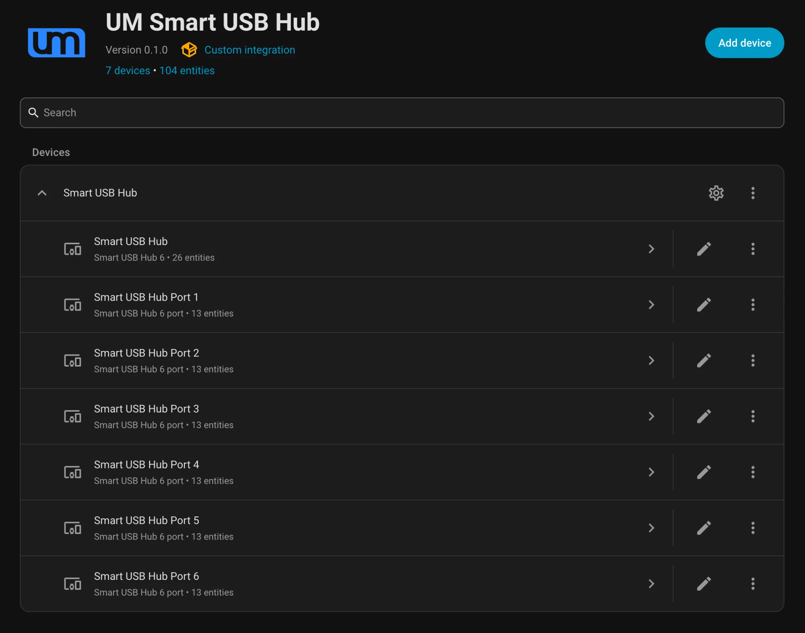
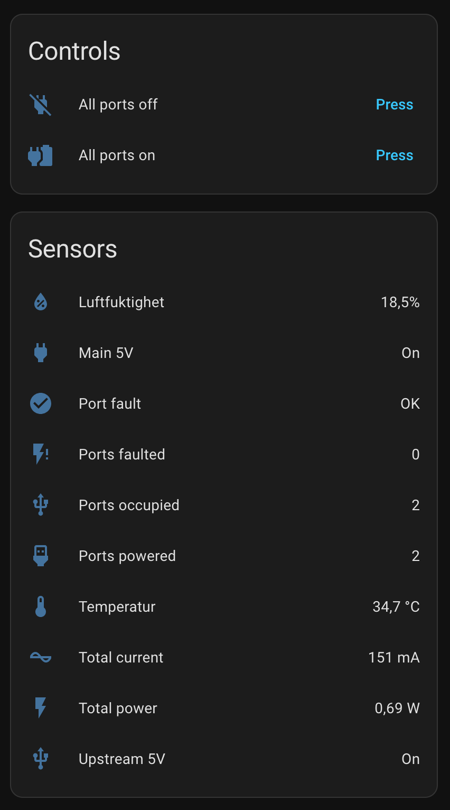
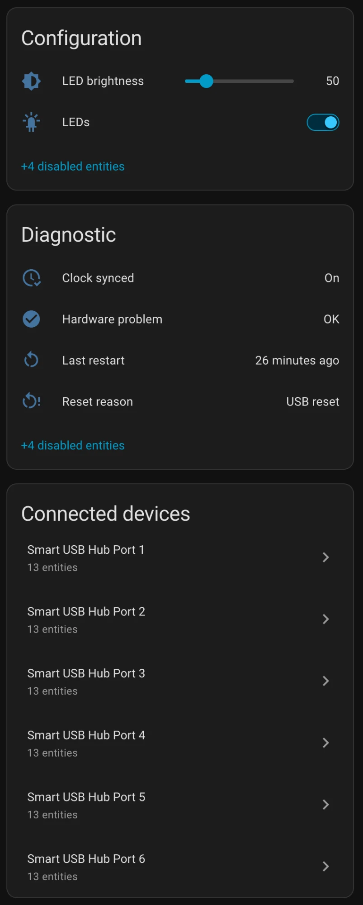
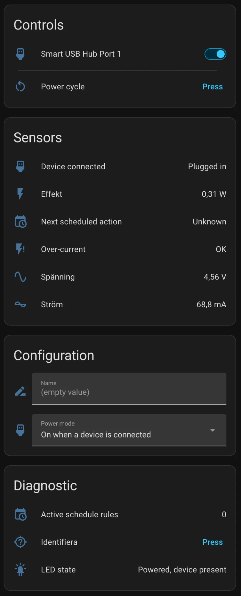

# UM Smart USB Hub for Home Assistant

A Home Assistant custom integration for the
[Unexpected Maker Smart USB Hub](https://github.com/UnexpectedMaker/um_smart_usb_hub_6).
It uses the hub's local [REST API](https://github.com/UnexpectedMaker/um_smart_usb_hub_6/blob/main/docs/rest_api.md),
so it can show more than the stock ESPHome integration: voltage, current and power
per port, over-current faults, power rails, power modes, port names and the
on-hub schedules.

- Local polling, no cloud, no extra Python packages
- Found automatically on your network (zeroconf), or added by host name/IP
- One device for the hub, plus one sub-device per port, named after the port's
  name on the hub



## Installation

### Marketplace (recommended)

UM Smart USB Hub is available in the Home Assistant Marketplace (Home Assistant 2026.11 or newer).

1. Go to **Settings** > **Marketplace**
2. Search for **UM Smart USB Hub** and open it
3. Select **Install**, check the version, and select **Install** again

Or click the button to open UM Smart USB Hub directly in the Marketplace:

[](https://my.home-assistant.io/redirect/hacs_repository/?owner=jonnybergdahl&category=Integration&repository=HomeAssistant_UM_SmartUsbHub_Integration)

No restart is needed. Home Assistant goes straight to the setup flow described below.

> On Home Assistant 2026.10, install UM Smart USB Hub through HACS instead: search for **UM Smart USB Hub**, click **Download**, then restart Home Assistant. Older versions aren't supported.

### Manual

1. Copy the `custom_components/um_smart_usb_hub` folder into your Home Assistant `config/custom_components/` directory
2. Restart Home Assistant

## Setup

A hub with its default host name (`usb-hub`) is discovered automatically and shows up under **Settings** > **Devices & services** as a discovered device. Select **Add** to set it up.

Otherwise, click the button to add a UM Smart USB Hub to Home Assistant.

[](https://my.home-assistant.io/redirect/config_flow_start/?domain=um_smart_usb_hub)

You can also set it up manually:

1. Go to **Settings** > **Devices & services** > **Add integration**
2. Search for **UM Smart USB Hub**
3. Enter the hub's host name or IP address (e.g. `usb-hub.local` or `192.168.1.50`). Use the IP address if Home Assistant can't resolve `.local` names.
4. Click **Submit**

> To change the polling interval (default 5 seconds), open the integration's **Configure** action. Settings and schedules are re-read every 5 minutes, and right after every change made from Home Assistant. If the hub's address changes, use **Reconfigure**.

## Entities

### Hub

| Entity | Notes |
|---|---|
| Temperature, Humidity | From the AHT20; unavailable until the first valid reading |
| Total current, Total power | Sum over all monitored ports |
| Ports powered / occupied / faulted | |
| Main 5V, Upstream 5V | Power rails |
| Port fault | On when any port has tripped its over-current protection |
| All ports on / All ports off | Buttons |
| LEDs, LED brightness | Config |
| Last restart, Reset reason, Clock synced, Hardware problem | Diagnostic |
| WiFi signal, IP address, SSID, Free memory | Diagnostic, disabled by default |
| UTC offset, Measurement averaging, Detect location, ESPHome API | Config, disabled by default |

<p>
  
  
</p>

### Each port

| Entity | Notes |
|---|---|
| *(port name)* switch | Port power |
| Device connected | Works with the port powered off too |
| Over-current | |
| Voltage, Current, Power | Unavailable if the port's monitor chip is missing |
| Next scheduled action | Timestamp of the next on-hub schedule event, with `action` (on/off) as an attribute |
| Power mode | Manual, On at boot, On when a device is connected |
| Name | The port name stored on the hub; the port's device follows it |
| Identify | Flashes the port's LED three times |
| Power cycle | Off for 5 s, then on |
| LED state, Active schedule rules | Diagnostic |



Entities that use a standard Home Assistant name (Voltage, Current, Power,
Temperature, Humidity, Identify) follow your Home Assistant language, which is
why some labels in the screenshots are in Swedish.

The port power sensors report mW and can be used as the source for a
[Riemann sum integral](https://www.home-assistant.io/integrations/integration/)
helper if you want energy (kWh) in the Energy dashboard.

## Actions

Every action targets one or more **port switches** (or port devices).

| Action | What it does |
|---|---|
| `um_smart_usb_hub.power_cycle` | Off, wait `off_time` seconds (default 5), on |
| `um_smart_usb_hub.get_schedule` | Returns the port's schedule stored on the hub |
| `um_smart_usb_hub.set_schedule` | Replaces the port's schedule (the other ports are kept) |
| `um_smart_usb_hub.add_schedule_entry` | Appends one rule to the port's schedule |
| `um_smart_usb_hub.clear_schedule` | Removes all rules from the port |

The schedules run on the hub itself, so they keep working when Home Assistant is down.

A schedule rule has these fields:

| Field | Meaning |
|---|---|
| `days` | List of `sun` `mon` `tue` `wed` `thu` `fri` `sat` (or a bitmask, bit 0 = Sunday) |
| `time` | When the rule fires, `HH:MM` hub local time |
| `mode` | `off`, `on`, `on_for`, `on_until` or `on_every` |
| `duration` | Minutes on, for `on_for`, and pulse length for `on_every` (default 60) |
| `until` | End time for `on_until`, or the window end for `on_every` with `all_day: false` |
| `every` | Repeat interval in minutes for `on_every`, minimum 30 |
| `all_day` | `on_every` only: all day, or only between `time` and `until` (default true) |
| `once` | Fire once, then disable the rule (default false) |
| `enabled` | Default true |

The hub accepts rules that clash with other rules but won't act on them. The
action then succeeds, and a warning in the log names the rules the hub marked
invalid. `get_schedule` reports them with `invalid: true`.

### Examples

```yaml
# Power-cycle the Raspberry Pi on port 6 for 10 seconds
action: um_smart_usb_hub.power_cycle
target:
  entity_id: switch.smart_usb_hub_port_6
data:
  off_time: 10
```

```yaml
# Weekdays 07:30-17:00, plus a 15-minute pulse every hour at weekends
action: um_smart_usb_hub.set_schedule
target:
  entity_id: switch.smart_usb_hub_port_3
data:
  entries:
    - days: [mon, tue, wed, thu, fri]
      time: "07:30"
      mode: on_until
      until: "17:00"
    - days: [sat, sun]
      time: "00:00"
      mode: on_every
      duration: 15
      every: 60
```

```yaml
# Read a schedule into a variable
action: um_smart_usb_hub.get_schedule
target:
  entity_id: switch.smart_usb_hub_port_3
response_variable: schedule
```

## Using it together with ESPHome

The hub can also run the ESPHome API. Both integrations can be used together, but
you'll see the same ports twice. Once you've moved your automations to this
integration you can turn the ESPHome API off. Use the hub's web page, or enable the
**ESPHome API** switch (disabled by default) and turn it off.

The two integrations create separate devices. When the hub's firmware reports
its MAC address (`network.mac` in `/api/hub`), this integration adds it to its hub
device. Current Home Assistant versions (tested on 2026.11) don't merge devices
from different integrations on a shared MAC, so the ESPHome device stays separate.

## Security

The hub's API has no authentication. Anything on your network can switch ports
or change settings, so keep the hub on a network you trust. The integration never
reads or stores the WiFi password (which the hub's settings endpoint returns),
and the diagnostics download redacts addresses and names.

## Development

```sh
uv venv --python 3.14 && uv pip install -r requirements_test.txt
.venv/bin/pytest
.venv/bin/ruff check . && .venv/bin/ruff format --check .
```

The test fixtures in `tests/fixtures` were captured from a hub running firmware 2.2.0.
